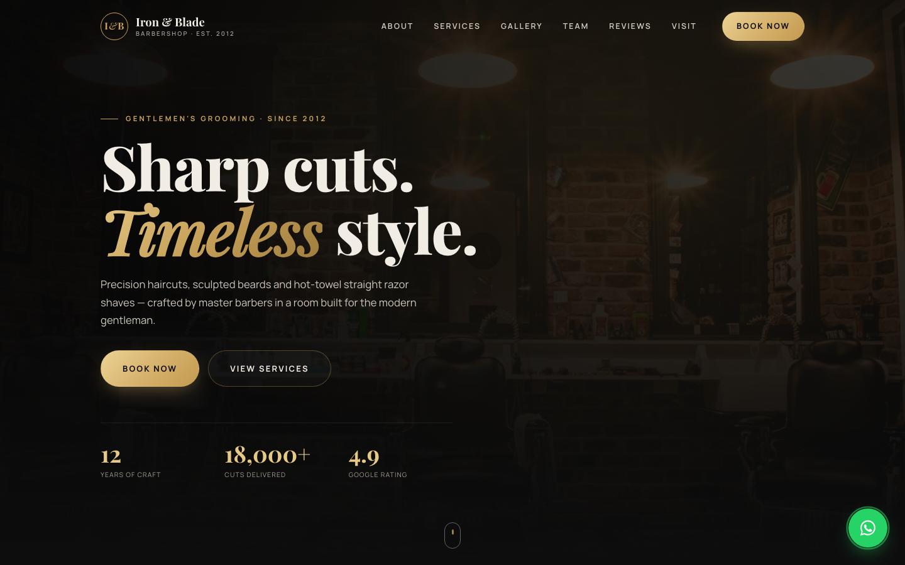

# Iron & Blade Barbershop

A premium, fully responsive landing page for a fictional barbershop — built as a portfolio piece with plain HTML, CSS and JavaScript (no frameworks, no build step).

**Live demo:** https://iron-and-blade-barbershop.vercel.app



## Features

- **Mobile-first, responsive layout** — tested from 360px phones up to wide desktop screens
- **Sticky navigation** with a blurred background on scroll, active-section highlighting and an animated hamburger menu on mobile
- **Scroll-reveal animations** and refined hover effects, with full `prefers-reduced-motion` support
- **Services & pricing** — six services with price and duration
- **Gallery** with a keyboard-accessible lightbox
- **Live opening hours** — today is highlighted, with an "Open now / Closed" status
- **Booking form** with validation, time slots generated from the opening hours (Sundays and past times blocked) and an animated confirmation
- **Floating WhatsApp button**

## Tech

- HTML5, CSS3 (custom properties, grid, flexbox, `clamp()`), vanilla JavaScript (IntersectionObserver)
- Google Fonts: Playfair Display + Manrope
- Images from [Unsplash](https://unsplash.com)
- Hosted on [Vercel](https://vercel.com)

## Project structure

```
index.html      Page markup
css/style.css   All styles (mobile-first, breakpoints at 600px / 900px / 1200px)
js/main.js      Navigation, animations, lightbox, opening hours, booking form
```

## Run locally

Open `index.html` in any browser, or serve the folder:

```bash
python3 -m http.server 8000
# then visit http://localhost:8000
```

---

*Demo website — Iron & Blade is a fictional business. The booking form does not send real reservations.*
